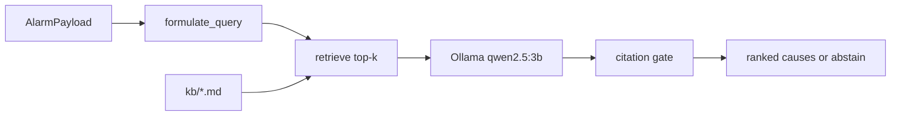

# scada-rag-copilot

A local **grounded** copilot for wind-turbine SCADA alarms. You pass a simulated alarm (turbine id, alarm code, timestamp, recent tag snapshot, optional twin/GNN context). It retrieves short knowledge-base notes, then a local LLM ranks likely root causes **with citations**. Every cause must quote a retrieved chunk; if nothing passes the citation gate, the answer is **no grounded cause found** — not a guess.

The hybrid twin in [wind-digital-twin](https://github.com/mehmetertac/wind-digital-twin) and electrical context from [grid-gnn-faults](https://github.com/mehmetertac/grid-gnn-faults) can be attached as structured fields in the alarm payload. This repo does not call those services.

Pipeline: [docs/ARCHITECTURE.md](docs/ARCHITECTURE.md). Status: [handover.md](handover.md).

## Architecture



## Quickstart

```powershell
py -3.11 -m venv .venv
.\.venv\Scripts\Activate.ps1
pip install -e ".[dev]"
pre-commit install

python -m scada_rag.ingest
python -m scada_rag.retrieve --query "gearbox HSS bearing temp rising at partial load"

# Grounded agent (needs Ollama)
ollama pull qwen2.5:3b
python -m scada_rag.eval_alarms

pytest tests/ -q
python scripts/sanity_queries.py
```

The first ingest downloads `BAAI/bge-small-en-v1.5` (~130 MB) into `storage/chroma/` (gitignored).

## Eval (v0.1.0)

Twelve synthetic alarms in [eval/alarms.yaml](eval/alarms.yaml) with hand-labelled expected notes. Full per-scenario table: [results/eval_alarms.md](results/eval_alarms.md). Refresh with `python -m scada_rag.eval_alarms`.

| Metric | RAG | No retrieval |
| --- | --- | --- |
| Top-1 cause hit rate | 83% | — |
| Top-3 cause hit rate | 83% | — |
| Grounding check pass rate | 83% | — |
| Answers citing a `.md` manual section | — | 0% |
| Answers naming labelled note (specificity) | — | 58% |

RAG should score higher on specificity and should not hallucinate manual filenames when citations are enforced. The no-retrieval baseline often cites plausible-sounding `.md` sections that were never retrieved.

## O&M desk at 3 a.m.

When a gearbox or pitch alarm wakes the on-call engineer, the first minutes are spent paging PDFs and tribal knowledge. This copilot does not replace the OEM manual or a start/stop decision. It **narrows** the search: ranked hypotheses tied to the same SCADA tags in the alarm, each with a quoted passage from your site’s runbooks and a suggested next check. If the library has nothing relevant, it says so instead of inventing a cause.

## Demo

[notebooks/01_demo.ipynb](notebooks/01_demo.ipynb): ingest, five sanity queries, one HSS-bearing alarm through `RootCauseAgent.propose`.

## Layout

| Path | Role |
| --- | --- |
| [kb/](kb/) | 13 fault/procedure/reference notes |
| [eval/alarms.yaml](eval/alarms.yaml) | Labelled synthetic alarms for eval |
| [src/scada_rag/agent.py](src/scada_rag/agent.py) | Retrieve → prompt → JSON → citation gate |
| [src/scada_rag/eval_alarms.py](src/scada_rag/eval_alarms.py) | Eval CLI |
| [configs/rag.yaml](configs/rag.yaml) | Embed model, chunking, Ollama model |

## Honest limitations

- Alarms and labels are **synthetic**; the KB is small (13 notes), not an OEM alarm encyclopedia.
- No live SCADA, no remote commands, no agent **tools** beyond retrieval.
- Thresholds in notes are site-practice examples — confirm setpoints on the platform.
- **Obvious extension (not built here):** let the agent call the twin’s `/twin/rul` endpoint as a tool so RUL and residual evidence enter the loop automatically.

## Sanity check

Five queries must return the expected note in the top 3: [results/sanity_queries.md](results/sanity_queries.md).
