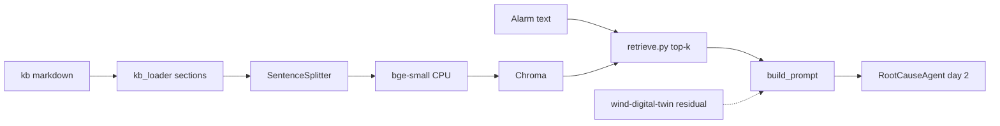

# Architecture

Day-1 scope is the knowledge base and retrieval. The chat model that turns retrieved sections into a ranked cause list is day 2 (local Ollama). The hybrid drivetrain twin is not imported. The knowledge base tells the reader which twin residual to request, and the prompt forbids claiming the twin was queried.

Sibling projects this copilot is written to sit beside:

- [wind-digital-twin](https://github.com/mehmetertac/wind-digital-twin) — gearbox thermal ODE, learned residual, hybrid anomaly flag.
- [wind-turbine-anomaly](https://github.com/mehmetertac/wind-turbine-anomaly) — earlier physics-residual anomaly baseline.
- [grid-gnn-faults](https://github.com/mehmetertac/grid-gnn-faults) — electrical fault classification. Relevant to grid-side alarms, not to bearing temperature.

## Flow

The dashed edge is operational, not a code dependency. A section may say "ask the twin for the `Gear_Bear_Temp_Avg` residual." Nothing in this repository opens that service.

## What a chunk carries

Each `kb/*.md` file has YAML front matter (`title`, `component`, `doc_type`, `tags`) and `##` sections. `kb_loader` emits one llama-index document per section, with metadata:

| Field | Use |
| --- | --- |
| `doc_title` | Front-matter title, shown in retrieval output |
| `section` | The `##` heading |
| `source` | File name, used by the sanity checks |
| `component` | gearbox, generator, pitch, converter, yaw, hydraulic, grid, drivetrain, operations, scada |
| `doc_type` | `fault`, `procedure`, or `reference` |
| `tags` | Comma-separated, because Chroma metadata values must be scalars |

The embedded text is the title, the section name, and the body. Metadata is not embedded a second time.

`SentenceSplitter` then cuts long sections to about 400 tokens with 60 tokens of overlap. Short sections stay one chunk and keep the same metadata.

## What the stack will not do

- It will not invent an OEM trip setpoint. Thresholds in the escalation note are labeled as site-practice examples.
- It will not read live SCADA. Queries are text.
- It will not start or stop a turbine. The escalation note is a document the retriever can find.
- `RootCauseAgent.propose` raises `NotImplementedError` until Ollama is wired.

## Configuration

All of the above is set in [configs/rag.yaml](../configs/rag.yaml): model name, chunk size, overlap, top-k, collection name, and the Ollama model name reserved for day 2. Tests pass `--embed-mode mock` so they do not download `bge-small`.
