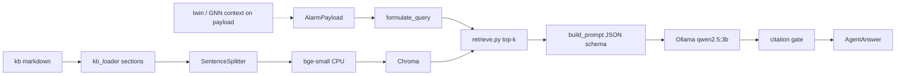

# Architecture

Local knowledge base, dense retrieval, and a **grounded** root-cause agent (Ollama). The hybrid drivetrain twin and grid-gnn-faults are optional **context on the alarm payload**, not Python dependencies.

Sibling projects:

- [wind-digital-twin](https://github.com/mehmetertac/wind-digital-twin) — gearbox thermal ODE, learned residual.
- [wind-turbine-anomaly](https://github.com/mehmetertac/wind-turbine-anomaly) — physics-residual baseline.
- [grid-gnn-faults](https://github.com/mehmetertac/grid-gnn-faults) — electrical fault classification.

## Flow

The dashed edge is structured fields only (`anomaly_score`, `shap_sensors`). Nothing in this repository HTTP-calls the twin. A future agent could add a `/twin/rul` tool.

## Agent contract

1. **Query** — alarm code + SCADA tag names (+ SHAP tag names if present).
2. **Retrieve** — top-k chunks with `source`, `section`, full text.
3. **Complete** — JSON: ranked `causes` with `source`, verbatim `quote`, `supporting_signal`, plus `next_check` and `confidence`.
4. **Cite** — drop any cause whose `source` is not in the hit list or whose `quote` is not a substring of that source’s retrieved text. Empty list → `no grounded cause found`.

Baseline eval (`use_retrieval=False`) uses the same JSON schema but skips retrieval and measures hallucinated `.md` citations.

## Chunk metadata

Each `kb/*.md` file has YAML front matter and `##` sections. Metadata on every chunk:

| Field | Use |
| --- | --- |
| `doc_title` | Shown in retrieval output |
| `section` | `##` heading |
| `source` | File name (sanity checks, citations) |
| `component` | gearbox, generator, pitch, … |
| `doc_type` | `fault`, `procedure`, `reference` |
| `tags` | Comma-separated |

Embedded text is title + section + body. `SentenceSplitter` cuts long sections (~400 tokens, 60 overlap).

## What the stack will not do

- Invent OEM trip setpoints.
- Read live SCADA or send commands.
- Claim the twin was queried unless a future tool is added.
- Propose causes without a passing citation when retrieval is enabled.

Configuration: [configs/rag.yaml](../configs/rag.yaml).
